# Commander Keen in the Mystery of Isis IIa - Web edition

## ▶ [Play Isis IIa in your browser](https://isonian314.github.io/commander-keen-isis-iia-web/)

## ▶ [Play Isis IIa in your browser (fullscreen)](https://isonian314.github.io/commander-keen-isis-iia-web/fullscreen/)

 |

This repo contains a vanilla Javascript port of the Python3 version of "Mystery of Isis IIa". It is a faithful recreation of the original, designed so that anyone can play it on the web without having to download the otherwise required Python dependencies.

**NB** - there are now (as of late 2026) three repos representing different variants of this game:

1. The original repo (with source code for the Python versions) can be found [here](https://github.com/isonian314/commander-keen-isis-iia-1.1). 
2. The online playable Javascript web-port of the original can be found [here](https://github.com/isonian314/commander-keen-isis-iia-web).
3. The enhanced (full skeleton of 16-levels, skeleton world map navigation) *is this repo*. 

# Full game documentation (new)

Everything below was worked out from the game's own code and data: enemy hit points, speeds, item values and the contents of each level file. The pictures are cut straight from its sprite sheets by `tools/build_docs.py` into `docs/img/`. The same guide, with the game playable above it, is on the [web page](https://isonian314.github.io/commander-keen-isis-iia-web/).

* [How to play](#how-to-play)
* [Keys and gamepad](#keys-and-gamepad)
* [Keen's moves](#keens-moves)
* [The status bar (HUD)](#the-status-bar-hud)
* [Health, lives and damage](#health-lives-and-damage)
* [Scoring and level rating](#scoring-and-level-rating)
* [Items](#items)
* [Powerups](#powerups)
* [Inventory](#inventory)
* [Weapons](#weapons)
* [Enemies](#enemies)
* [Hazards and obstacles](#hazards-and-obstacles)
* [Levels](#levels)
* [Story](#story)
* [Cheats and debug keys](#cheats-and-debug-keys)
* [Quirks and curiosities](#quirks-and-curiosities)

## How to play

Pick **New Game** on the title screen. Each level is a large scrolling map: find the exit and walk into it to finish. Along the way, collect point items (to score), health items, keys for locked doors, ammunition, powerups and inventory gadgets. Finishing a level shows a statistics screen (items, points and enemies, as percentages) and a star rating, then the next cutscene.

* **Title menu:** New Game, Load Level, Options and Quit. `F1` opens Help (Controls, Story, Isis, Items and History).
* **Load Level** lets you replay any level you have reached. It restores the lives, health, score, ammo and inventory you had when you finished the level before it. Progress is kept in your browser (16 save slots, one per level, including 7 levels that were never built; they show as grey boxes).
* **Options:** load a custom level (a Tiled `.tmx` file), sound on/off, music on/off and clear statistics.
* **Checkpoints** (flags) in levels 3 and 4 mark where you restart after losing a life. Otherwise you restart at the beginning of the level.
* Pressing `Esc` during a level quits to the title screen and ends the game.

## Keys and gamepad

Use `Z` for jump and `X` for pogo. The original `Ctrl` and `Shift` still work, but browsers react badly to them: `Ctrl`+`W` closes the tab, `Ctrl`+number switches tabs, and on macOS `Ctrl`+arrow switches desktops. Every key except `Esc` and `Enter` can be rebound in the settings panel (the gear in the top-right corner of the game, or `` ` `` / `F10`).

| Key | Action |
| --- | --- |
| `←` `→` | Run (or swim) left and right |
| `↑` | Look up, grab or climb a pole, go through a door, flip a switch, aim up, swim up |
| `↓` | Look down, climb down a pole, aim down in the air, swim down |
| `Z` (or `Ctrl`) | Jump. Hold it for a higher jump; hold it in water to swim faster |
| `X` (or `Shift`) | Get on or off the pogo stick |
| `Space` | Shoot the current weapon |
| `1` – `8` | Select a weapon (see [Weapons](#weapons)) |
| `F1` `F2` `F3` | Switch the Battery, Shield or Ion Scanner on or off |
| `Enter` | Select in menus, skip cutscenes |
| `Esc` | Back in menus; quit to the title from a level |
| `` ` `` or `F10` | Settings panel (pauses the game) |

On a gamepad (turn it on in the settings panel), the D-pad or left stick moves, **A** jumps, **B** pogos, **X** or **Y** shoots, **Start** is Enter and **Back** is Esc.

On the web page, buttons under the game do the same as the sound, music, inventory and cheat keys. The game only takes the keyboard while at least half of it is on screen; scroll down and it pauses, so the page can scroll normally.

## Keen's moves

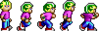 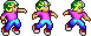 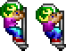

* **Run:** 110 pixels per second, about 7 tiles (a tile is 16 pixels).
* **Jump:** a quick press gives a short hop. Holding jump keeps pushing Keen up for 0.3 seconds. Gravity is 450 px/s² and Keen falls at most 400 px/s.
* **Pogo:** press `X` to hop on. Keen bounces by himself; hold jump as he lands for a much bigger bounce. Press `X` again to get off.
* **Look up and down:** hold `↑` or `↓` while standing still to pan the view.
* **Drop through a platform:** `↓` + jump while standing on a platform you can jump up through.

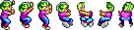 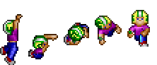

* **Poles:** press `↑` as you jump or fall past a pole to grab it, or `↓` while standing on the top of one. Climb up at 50 px/s and slide down at 100 px/s. Jump to let go (with half a normal jump).
* **Ledges:** fall past the edge of a ledge while holding towards it and Keen grabs on. Press `↑` or towards the wall to climb up (about a second), or away to drop.
* **Doors:** press `↑` in front of a door and Keen walks through and comes out of its partner door elsewhere in the level.
* **Switches:** stand still at a switch and press `↑`. Switches start and stop the moving platforms they are linked to.
* **Locked doors:** walk into one while holding a key of the same colour. The key is used up and the door slides open.

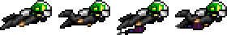 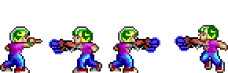 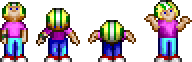

* **Swimming:** in water the arrows move Keen in every direction (55 px/s, or 1.5 times that while holding jump). The Harpoon is selected automatically, and your previous weapon comes back when you climb out.
* **Shooting:** `Space` fires one shot per press (no autofire). Hold `↑` to shoot upwards, or `↓` while in the air to shoot downwards. The Blowgun and Plutezarp only fire forwards. Keen can't shoot while hanging from a ledge, going through a door, or in God or Crazy mode. Shooting on the ground stops Keen for a quarter of a second, and shooting from the pogo stick knocks him off it.
* **Stomping:** landing on a Spider with the pogo stick kills it. It's the only enemy that can be stomped.
* **Idling:** leave Keen alone and after 10 seconds he looks up at you; after 15 he shrugs.

## The status bar (HUD)

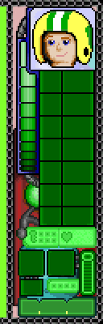

The status bar runs down the left of the screen. From top to bottom:

* **Keen's face.** It smiles after picking something up, looks worried at 6 health or less, and hurt at 4 or less. It also changes for God mode, Crazy mode and dying: 
* **Health bar**, 10 segments.
* **Weapons** with their ammo: Plutezarp at the top, then HR-42, Solarizer, Pulsar, Zeffer and Blowgun, with the Harpoon at the bottom. A weapon appears once you've picked it up, and is greyed out when its ammo runs out. The two secret weapons show up in a separate slot only while selected.
* **Light globe**, which changes colour when Keen heals, gets hurt, or has a powerup: 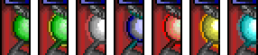
* **Keys** held, and **lives**.
* **Powerup** icon and the seconds it has left.
* **Inventory**: the active gadget with its power bar, and a dot for each gadget you own.
* **Score**, 8 digits.

 

## Health, lives and damage

* Keen starts with **3 lives** and **10 health**. Lives go up to 99.
* Touching an enemy, a bullet or a hazard costs health; each enemy below lists its damage. Afterwards Keen flashes and can't be hurt for 1 second.
* Hazard tiles (thorns, spikes, acid, lava and so on) do 1, 2 or 5 damage, or kill outright.
* At 0 health Keen loses a life and drops any keys he was carrying. The level restarts at the last checkpoint, with 10 health. He keeps his score, ammo and inventory. Losing the last life is game over and returns you to the title screen.

## Scoring and level rating

Points come **only from point items**; shooting enemies scores nothing. Picking up a **Point Multiplier** makes point items worth four times as much for 5 seconds. The score tops out at 99,999,999.

| | Item | Points | With multiplier |
| --- | --- | ---: | ---: |
|  | Jelly Bean (six colours) | 100 | 400 |
|  | Isonian Cola | 200 | 800 |
| 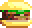 | Triple Cheeseburger | 500 | 2,000 |
| 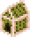 | Gingerbread House | 1,000 | 4,000 |
|  | Bag o' Sugar | 2,000 | 8,000 |
| 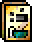 | IQ Cereal | 5,000 | 20,000 |

The original nine levels together hold 385,400 points' worth of items (before multipliers); with levels 10–16 the total is 445,700.

### End-of-level statistics

The statistics screen shows the share of **items**, **points** and **enemies** you got. Only *items* count towards the star rating. Here, items means jelly beans, the five food items, batteries, shields and ion scanners. Health items, keys, weapons and powerups don't count. Points are counted before the multiplier.

| Items collected | 100% | 90%+ | 80%+ | 70%+ | 60%+ | 50%+ | 40%+ | 30%+ | 20%+ | less |
| --- | --- | --- | --- | --- | --- | --- | --- | --- | --- | --- |
| **Stars** | 10 | 9 | 8 | 7 | 6 | 5 | 4 | 3 | 2 | 1 |

Your best rating for each level is shown in the Load Level menu, and finishing a level unlocks the next one there.

## Items

### Health and lives

| | Item | Effect |
| --- | --- | --- |
|  | Pyapa Fruit | +1 health |
| 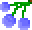 | Peeta Berries | +3 health |
| 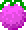 | Isis Fruit | +5 health |
| 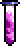 | Life Potion | +10 health (full) |
| 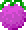 | Nephthys Fruit | −3 health. It looks almost exactly like an Isis Fruit. The help screen says it won't kill Keen, but in the code it does if he has 3 health or less. |
| 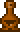 | Chocolate Yorp | +1 life |

Health items stay where they are if Keen already has full health, and so do Chocolate Yorps at 99 lives.

### Keys

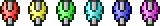

There are six keys: red, yellow (gold), green, cyan, blue and magenta. Keen can carry one of each. Walk into a locked door of the same colour to open it, which uses up the key. Keys are lost when Keen loses a life.

## Powerups

Only one powerup is active at a time; picking up another replaces it. The HUD shows its icon and the seconds left.

| | Powerup | Lasts | What it does |
| --- | --- | ---: | --- |
|  | Super Sneakers | 10 s | Faster running (140 instead of 110 px/s) and higher jumps and pogo bounces. The help screen says they also protect Keen's feet, but the code only makes him faster. |
|  | Point Multiplier | 5 s | Point items are worth 4 times as much. |
|  | God Mode | 10 s | Keen glows gold and nothing can hurt him. He runs at 170 px/s, jumps higher and falls more slowly, but can't shoot. |
|  | Crazy Keen | 10 s | A bad one: left and right are swapped, and his speed and jump height change at random every second and a half. He can't shoot, grab poles or use the Battery. When it wears off he is sick on the spot. |
|  | Regeneration | 20 s | +1 health every 2 seconds. |
|  | Degeneration | 20 s | −1 health every 2 seconds, and it can kill. Grab an Anti Powerup or wait it out with a full health bar. |
|  | Anti Powerup | 3 s | Cancels whatever powerup Keen has, good or bad. |

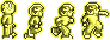 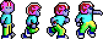 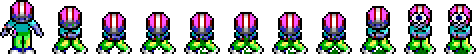

God Mode and Regeneration exist in the code but aren't placed in any level.

## Inventory

Gadgets you keep once found. Each one has a power level, and it switches off when the power runs out. Each Battery you collect raises the maximum power by one (up to 20). Press `F1`, `F2` or `F3` to switch a gadget on; pressing it again, or choosing another, switches it off. Only one can be on at a time.

| | Gadget | Key | What it does | Found in |
| --- | --- | --- | --- | --- |
| 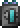 | Battery | `F1` | While switched on it drains 1 unit every 2 seconds and charges the other gadgets at the same rate. When it is off, its solar panel recharges it by 1 unit every 4 seconds. | Every level except 7 (11 in total) |
| 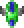 | Shield | `F2` | Uses 1 unit a second. Blocks enemy bullets coming at Keen from the front while he's on the ground, in the air or on the pogo stick (not on poles, on ledges or in water). | Level 4, Cave |
| 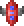 | Ion Scanner | `F3` | Uses 1 unit a second and shows a health bar over every enemy. | Level 6, Artillery Division |

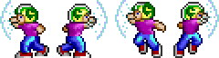

Your inventory and battery capacity survive a game over, as in the original game. The code also has a fourth, unnamed gadget (`F4`, 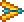) that does nothing and isn't placed anywhere.

## Weapons

Keen starts with no weapons. Each weapon pickup gives **5 shots** (up to 99) and, if Keen has nothing selected, selects it. When a weapon runs out, Keen switches to the next weaker weapon that still has ammo. Damage is taken off the enemy's hit points (listed under [Enemies](#enemies)). Speeds are in pixels per second.

| Key | Weapon | Shot | Damage | Speed | How it behaves | Found in |
| --- | --- | --- | ---: | ---: | --- | --- |
| `1` | 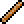 Blowgun (Blowdart) |  | 1 | 200 | Flies straight for half a second, then drops. Forwards only. | Levels 1, 2, 3, 5, 9 |
| `2` | 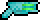 Zeffer 4000 |  | 2 | 250 | Wobbles along a sine wave and leaves a purple trail; half its shots also drift upwards. Good for covering an area. | Levels 2 to 9 |
| `3` | 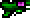 Pulsar |  | 4 | 250 | Goes straight through enemies, but its damage halves with each one it hits (4, 2, 1, 1…). | Levels 3 to 9 |
| `4` | 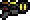 Solarizer |  | 8 | 150 | Explodes on impact. The explosion kills Keen if he touches it, so don't fire it at a nearby wall. | Levels 8, 9 |
| `5` | 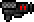 HR-42 (Hell Rifle) | 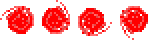 | 16 | 150 | Heavy, slow bolts. | Not placed (cheat only) |
| `6` | 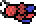 Plutezarp |  | 32 | beam | A laser beam that grows to 100 pixels over 0.375 s, then fades. The first enemy it reaches takes 32 damage, and so does anything else it overlaps at that moment. Forwards only. (The "deadly residue" in the help text was never added.) | Not placed (cheat only) |
| `7` | 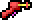 Raygun (secret 1) |  | 1 | 200 | Keen's classic raygun. | Not placed (cheat only) |
| `8` | 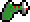 Neural Stunner (secret 2) |  | 1 | 200 | Keen's classic stunner, and the only weapon with its own sound. | Not placed (cheat only) |
| auto |  Harpoon |  | 1 | 100 | The only weapon that works underwater, and it only works there. It's selected automatically when Keen enters water. | Levels 2, 3, 4, 6 |

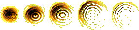

The HR-42 and Plutezarp are also removed from custom levels, so the only way to try them, or the two secret weapons, is the All Weapons cheat. The HUD calls it the HR-42, while the help screen calls it the Hell Rifle 32.

## Enemies

Stats are hit points (HP), the damage done by touching the enemy, and walking speed in pixels per second. Unless noted otherwise, walkers pace back and forth and turn at walls and at invisible markers placed by the level designers. They don't avoid ledges. Enemies give no points, but they count towards the "enemies" percentage at the end of a level. The groups follow the in-game Help.

### Jungle critters

#### Foog
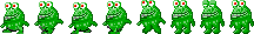

**HP** 2 · **touch** 1 · **speed** 35 · levels 1, 2, 5, 6, 9

The original inhabitants of the Isis jungles. A Foog wanders about, stops now and then to look around, and sometimes turns back.

#### Jumping Foog
**HP** 2 · **touch** 1 · **speed** 35 · levels 1, 2, 4, 5, 6, 9

Looks just like a Foog, but also leaps into the air at random, with a croak you can hear when it's on screen.

#### Spider
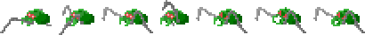 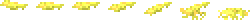

**HP** 2 · **touch** 2 · **speed** 50 · **spit** 5 · levels 1, 2, 6, 9

Spits a lump of goo at random moments (at most once every 3 seconds), whether Keen is nearby or not. The goo arcs forwards and, where it lands, leaves a puddle that hurts for 5 until it fades about six seconds later. The goo isn't used up when it hits Keen. Landing on a Spider with the pogo stick kills it.

#### Leafy (not in any level)
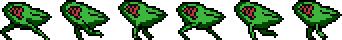

A camouflaged leaf insect that walks about.

### Cave and mountain dwellers

#### Hole Monster
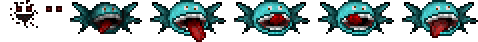

**HP** 4 · **touch** 2 · doesn't move · levels 3, 4

Hides in a hole in the rock. It peeks out when Keen comes within 64 pixels and lunges when he's within 32.

#### Blue Mouth
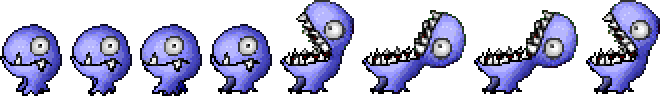

**HP** 8 · **touch** 3 · **speed** 50 · levels 3, 4, 9

Has a double-jointed jaw. When Keen is right above it (within 16 pixels across and 48 up), it opens its jaws upwards, so jumping over it rarely works.

#### Garnak
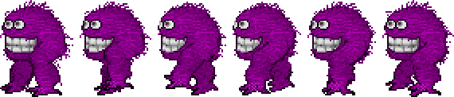

**HP** 10 · **touch** 5 · **speed** 40 · levels 4, 9

One of the toughest natives. It just walks, but a touch takes half your health.

#### Yellow Guy
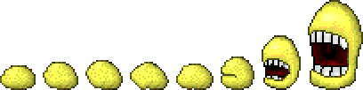

**HP** 8 · **touch** 4 · **speed** 20 · level 3

Gasping for air at high altitude. When Keen comes within 128 pixels across and 64 up or down, it turns to face him, opens its mouth and breathes in. That pulls Keen towards it, harder the closer he gets, and even drags him off poles and ledges.

#### Demon
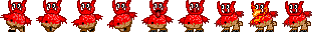 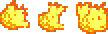

**HP** 6 · **touch** 3 · **speed** 100 · **fireball** 1 · level 6

A small, fast pest. It throws a fireball when Keen is in front of it, within 50 pixels and at the same height, at most every 3 seconds.

#### Frog
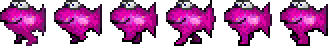 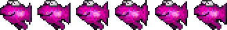

**HP** 2 · **touch** 1 · **speed** 35 · levels 3, 4

A pink frog (it isn't in the Help). One kind hops about on land; the other swims in caves.

### Marine life

#### Redfish
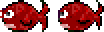

**HP** 2 · **touch** 1 · **speed** 35 · levels 2, 3

The most common fish in the Sea of Isis. It swims back and forth, and floats belly-up to the surface when shot.

#### Chomper

**HP** 2 · **touch** 3 · **speed** 55 · levels 2, 4, 6

The piranha of Isis. It starts opening its mouth when Keen is within 64 pixels and bites at 32.

#### Urchin

**HP** can't be killed · **touch** 1 · doesn't move · level 6

A poisonous sea-floor spike. Its spikes twitch when Keen comes within 50 pixels. Because it can't be killed, level 6 can never show 100% enemies.

#### Floppy and the radioactive fish (level 12)
   

A one-eyed stingray and deformed fish, the results of a nuclear testing site on Isis. They're drawn and described in the Help but weren't used in the original nine levels; the new Ocean Moat (level 12) places them, though they only drift for now.

### Army slaves

#### Lemming
 

**HP** 4 · **touch** 2 · **speed** 40 · **bullet** 1 · levels 5, 6

"About as stupid as the original lemmings, just not quite as suicidal." It shoots when Keen is in front within 100 pixels and at about the same height, at most every 3 seconds.

#### Lemming Truckie

**HP** 4 · **touch** 2 · **speed** 40 · **bullet** 1 · level 6

A more alert lemming with a driver's licence. Same range as a Lemming, but it can fire every 0.2 seconds, a stream of bullets.

#### Alien Trucky

**HP** 6 · **touch** 2 · **speed** 40 · **bullet** 1 · levels 5, 8

A truck driver from a nearby star system. Tougher than a Truckie; it fires once a second.

#### Cyborg Lemming
 

**HP** 20 · **touch** 5 · **speed** 65 · **bullet** 1 · level 9

The deadliest army slave. Shoots at close range (50 pixels), every 3 seconds at most. "Reacts interestingly to fire": kill it with the Solarizer and it melts.

#### Trucks (not in any level)
 

Trucks that drive back and forth (2 HP). Destroying one blows it up, and its driver jumps out and carries on the fight on foot.

### Robots

#### Grey Robot
 

**HP** 8 · **touch** 3 · **speed** 40 · **bullet** 1 · levels 6, 7, 8

A standard droid. It shoots when Keen is in front within 100 pixels and level with it, and every so often charges at two and a half times its normal speed.

#### Red Robot
 

**HP** 8 · **touch** 3 · **speed** 40 · **shell** 8 · level 6

"Transformers, Isis style." Within 50 pixels it unfolds into a cannon and fires an 8-damage shell that explodes against walls, at most every 5 seconds.

#### Flasher

**HP** 8 · **touch** 3 · **speed** 75 · **shell** 8 · levels 6, 7

A hunter that fires the same heavy shells as the Red Robot from up to 100 pixels away, and bursts into metal shards when destroyed.

#### Hovercraft
 

**HP** 8 · **touch** 3 · **speed** 75 · **bomb** 2 · level 5

A flying saucer that cruises back and forth. It drops a bomb on a 45° diagonal whenever Keen is ahead of it and on that line below it.

#### Tele Turret
 

**HP** 2 · **touch** 0 · doesn't move · **shot** 1 · levels 6, 8

Fires straight ahead every half second. When Keen is level with it and in front, it pulls back into the wall and can't be hurt until he moves away, so shoot it from above, from below, or as it comes back out.

### Isonians

#### Regular, Military and Scientist
   

All have **HP** 10 and are found in level 8.

| Isonian | Touch | Shot | Speed | Notes |
| --- | ---: | ---: | ---: | --- |
| Regular (green) | 2 | 2 | 40 | Shoots on sight. |
| Military (red) | 5 | 5 | 30 | A trained assassin. |
| Scientist (white) | 1 | 9 | 50 | Harmless at first: it won't shoot and turns its back on Keen. Once it's been hurt, it shoots back with 9-damage blasts. |

Isonians shoot when Keen is in front within 96 pixels and at the same height, once a second. When their health drops below half, they teleport to the nearest hiding spot in the level (Central Command has four). Shots pass straight through them while they teleport. At the hiding spot they heal 1 HP every 3 seconds, and once fully healed they teleport back to where they left.

#### Isonian fighter

**HP** 10 · **touch** 5 · **speed** 70 · level 7

A small Isonian craft parked in the Hangar. It floats back and forth and doesn't shoot; it looks like an unfinished enemy.

### Not used in the original nine levels

These enemies are fully coded but were never placed in the original nine levels. They can appear in custom levels, except the Shapeshifter and Evil Keen, which are removed from them too. The new levels 13–16 use most of them: Yorps, Gargs and Slugs on the Secret Island, the garden grubs and the bird in the Castle Garden and Imperial Castle, and Evil Keen and the Shapeshifter as stand-ins for RoboKeen and Mort on the rooftop.

   

The **Caterpillar** lies dormant and unhurtable until Keen comes close, then wakes up and crawls slowly (2 HP, touch 1). The **Giant Dragonfly** (4 HP) is harmless but shoves Keen around; hurt it badly enough and it drops to the ground and crawls. The **Snail** is a slow poisonous crawler (2 HP, touch 1), and the **Foog Warrior**, "a domesticated Foog", has 500 HP.

    

   

Also unused: a **Slug** that leaves a trail of harmful slime, a **Yorp** and a **Garg** from Keen 1, a **bird**, a **big frog**, and two **giant Isonians**. The **Shapeshifter** stands disguised as a tree until Keen gets close, then jumps around firing rapidly. **Evil Keen** runs, jumps and shoots like Keen himself.

## Hazards and obstacles

#### Mine

Can't be destroyed · levels 5 (54 of them!) and 6

Harmless until Keen comes within about 12 pixels. Then it arms, and a third of a second later it becomes deadly for an instant and blows up. Keep moving and you're usually past it in time; stop next to one and it kills you.

#### Rocks

**HP** 2 · harmless · levels 2, 3, 4, 6

Piles of rock blocking a passage. Shoot them twice to clear the way.

#### Drips

Water drips (harmless) and acid drips (1 damage) fall from ceilings, splash, and fall again 1 to 3 seconds later. Water drips are in levels 2, 3, 4 and 9; acid drips in level 6.

#### Hazard tiles

Some tiles hurt Keen for 1, 2 or 5 on contact, and some kill him outright. Deadly tiles are everywhere in the Cave (over 300) and the Mountain. God Mode protects Keen from all of them.

## Levels

The original game has nine levels. Levels 10–16 are new, generated placeholder levels (see [TODO.md](TODO.md)) that complete the story from the design doc, so the game now runs from the jungle to the epilogue. Each level ends at an exit that leads to the next, with a cutscene in between; the Ocean Moat has a second, hidden exit to the Secret Island, and both routes continue to the Castle Garden. Item and point totals are the amounts needed for 100%; enemy counts include only enemies that count in the statistics (not mines, rocks or drips).

| # | Level | Size (tiles) | Music | Enemies | Items for 100% | Points | Keys |
| ---: | --- | --- | --- | ---: | ---: | ---: | --- |
| 1 | Jungle | 272 × 138 | Branching Out | 22 | 175 | 67,500 | none |
| 2 | Jungle Nights | 411 × 110 | Branching Out Remix | 43 | 341 | 110,400 | yellow, magenta |
| 3 | Mountain | 300 × 164 | Thin Air | 25 | 357 | 81,300 | yellow, green, magenta |
| 4 | Cave | 256 × 201 | Tight Spaces | 35 | 107 | 28,600 | red, green, blue |
| 5 | Minefield | 286 × 60 | Infiltration | 16 | 49 | 11,500 | red, yellow, blue |
| 6 | Artillery Division | 256 × 165 | Flooded Flashback | 38 | 172 | 58,900 | yellow, cyan, blue, magenta |
| 7 | Hangar | 100 × 40 | The Core | 10 | 21 | 2,900 | cyan |
| 8 | Central Command | 140 × 150 | Rhythm of a Robot | 23 | 37 | 7,500 | yellow, green, blue |
| 9 | Dungeon | 145 × 101 | Cistern | 19 | 51 | 16,800 | red, yellow, cyan |
| 10 | Barracks | 150 × 46 | The Core | 9 | 60 | 15,000 | red |
| 11 | Missile Tower | 82 × 112 | Flooded Flashback | 11 | 49 | 6,400 | yellow |
| 12 | Ocean Moat | 172 × 66 | Branching Out Remix | 15 | 36 | 3,900 | none |
| 13 | Secret Island | 124 × 42 | Branching Out | 10 | 23 | 2,300 | cyan |
| 14 | Castle Garden | 152 × 46 | Art of Gardens | 10 | 20 | 2,000 | green |
| 15 | Imperial Castle | 140 × 58 | Cistern | 12 | 81 | 30,000 | blue, yellow |
| 16 | Rooftop Showdown | 124 × 40 | Rhythm of a Robot | 2 | 5 | 700 | none |

### 1. Jungle

> "I wonder if I can sneak through this jungle undetected..."

* **Enemies:** Foog 13, Jumping Foog 4, Spider 5
* **Pickups:** Blowgun ×9 · Super Sneakers, Point Multiplier, Chocolate Yorp, Battery
* No keys needed. A gentle start: learn to pogo and to stomp Spiders.
* [Full map](resources/maps/level1-jungle-full.png)

### 2. Jungle Nights

> "Just how big IS this jungle anyway?! It's getting late, and I think I see a storm approaching..."

* The widest level. Night falls as you play (the screen darkens over ten minutes), with rain and lightning. Large flooded areas.
* **Enemies:** Foog 17, Jumping Foog 9, Spider 4, Redfish 8, Chomper 5
* **Pickups:** Blowgun ×9, Zeffer ×1, Harpoon ×8 · Crazy Keen, Life Potion, Nephthys Fruit, Chocolate Yorp, Battery. The most points of any level.
* [Full map](resources/maps/level2-jungle-full.png)

### 3. Mountain

> "These mountains sure look steep... it MUST be on the other side! Brrr, it's going to be cold up there!"

* Snow and drifting clouds, a checkpoint, and the first switch-operated moving platform.
* **Enemies:** Yellow Guy 9, Hole Monster 7, Blue Mouth 5, Frog 2, Redfish 2
* **Pickups:** Blowgun ×7, Zeffer ×10, Pulsar ×2, Harpoon ×1 · 3 Chocolate Yorps, 3 Point Multipliers, Battery. The most items of any level.
* [Full map](resources/maps/level3-mountain-full.png)

### 4. Cave

> "Wow, those mountains were a bit too rugged for my liking. Perhaps I should try going through them instead..."

* The tallest level. Two checkpoints, underground lakes, no poles and lots of deadly tiles.
* **Enemies:** Hole Monster 10, Frog 8 (+2 swimming), Blue Mouth 6, Garnak 6, Chomper 2, Jumping Foog 1
* **Pickups:** Zeffer ×7, Pulsar ×10, Harpoon ×2 · **Shield**, 2 Batteries, 2 Chocolate Yorps
* [Full map](resources/maps/level4-cave-full.png)

### 5. Minefield

> "Uh oh, I'd better be careful here! These Isonians sure don't like visitors."

* **54 mines**, plus the first Isonian army troops.
* **Enemies:** Lemming 6, Hovercraft 4, Foog 3, Alien Trucky 2, Jumping Foog 1
* **Pickups:** Blowgun ×1, Zeffer ×3, Pulsar ×2 · Super Sneakers, Anti Powerup, Degeneration, Chocolate Yorp, Battery
* [Full map](resources/maps/level5-minefield-full.png)

### 6. Artillery Division

> "\*GULP\*! So much for being undetected... Here goes nothing!"

* Keen starts facing left. The most varied level: robots, turrets, acid drips, mines and a flooded section.
* **Enemies:** Red Robot 7, Grey Robot 6, Lemming 5, Urchin 4, Lemming Truckie 3, Tele Turret 3, Chomper 3, Spider 2, Demon 2, Flasher 1, Foog 1, Jumping Foog 1 (plus 6 mines)
* **Pickups:** Zeffer ×6, Pulsar ×2, Harpoon ×1 · **Ion Scanner**, Battery, 2 Chocolate Yorps, Life Potion, Super Sneakers, Anti Powerup, Degeneration
* [Full map](resources/maps/level6-artillery-full.png)

### 7. Hangar

> "Wow, by the look of that underground base, Isis IIa sure got a beating recently! I might duck for cover in this hangar for a while..."

* The smallest level, with moving platforms and parked Isonian fighters.
* **Enemies:** Grey Robot 6, Flasher 2, Isonian fighter 2
* **Pickups:** Zeffer ×3, Pulsar ×1
* [Full map](resources/maps/level7-hangar-full.png)

### 8. Central Command

> "This must be their headquarters. Now I'll find out who's behind this and put a stop to it!"

* Keen starts facing left. A tall base full of poles and platforms, home of the Isonians themselves.
* **Enemies:** Tele Turret 6, Alien Trucky 5, Regular Isonian 4, Military Isonian 3, Grey Robot 3, Scientist Isonian 2
* **Pickups:** Zeffer ×5, Pulsar ×3, Solarizer ×2 · 2 Batteries, Life Potion, Super Sneakers, Point Multiplier
* [Full map](resources/maps/level8-central_command-full.png)

### 9. Dungeon

> "The fleet awaits. For the glory of Isis 2 and our divine teacher!" (the Isonian commander, as he drops Keen through a trapdoor)

* Keen lands with 5 health missing after the fall. The dungeon is littered with bad powerups: 14 Degeneration and 10 Crazy Keen (with 4 Anti Powerups).
* **Enemies:** Jumping Foog 5, Foog 4, Blue Mouth 4, Spider 3, Garnak 2, and one Cyborg Lemming
* **Pickups:** Blowgun ×1, Zeffer ×3, Pulsar ×1, Solarizer ×1 · 2 Batteries, Chocolate Yorp
* The exit used to end the game with a "thanks for playing" screen; it now leads on to the Barracks.
* [Full map](resources/maps/level9-dungeon-full.png)

### 10. Barracks

> "Nobody here... they must be out boarding the fleet!"

* A three-storey Isonian base building: white platforms, blue panel walls and poles between the floors. The red key on the top floor opens the way out on the ground floor, and a two-way door leads up to a bonus area on the roof. Two checkpoints.
* **Enemies:** Lemming 3, Cyborg Lemming 2, Lemming Truckie 1, Alien Trucky 1, Grey Robot 1, Red Robot 1
* **Pickups:** Zeffer ×1, Pulsar ×1 · Pyapa Fruit, Nephthys Fruit
* [Full map](resources/maps/level10-barracks-full.png)

### 11. Missile Tower

> "(angrily) This won't be leaving Isis II... Ever."

* A seven-floor climb up the tower by poles and platform stairs. The yellow key halfway up opens the launch deck at the top, where **Robo Grey** guards the exit. One checkpoint.
* **Enemies:** Grey Robot 2, Lemming 2, Isonian fighter 2, Cyborg Lemming 1, Red Robot 1, Lemming Truckie 1, Robo Grey 1, Robo Blue 1. Robo Grey and Robo Blue have no code of their own yet; they behave as a tougher Grey Robot and Flasher.
* **Pickups:** Zeffer ×1, Pulsar ×1 · Life Potion
* [Full map](resources/maps/level11-missile_tower-full.png)

### 12. Ocean Moat

> "I think I know who I'm going to find over there. Earth isn't getting pushed around by the likes of you, do you hear me?"

* Keen starts in the water and swims across the Sea of Isis to the castle island (exit to level 14). A shaft in the sea floor leads to a fork with two signs in the Standard Galactic Alphabet: "TAKE THE BLUE PILL" loops back up to the sea, while "TAKE THE RED PILL" leads down to a flooded brimstone grotto with lava pools, the **Devil**, the **Solarizer** and a hidden exit to the Secret Island (level 13).
* **Enemies:** Redfish 4, Chomper 2, Floppy 2, Urchin 2, Yellow fish 2, Green fish 1, Blue fish 1, Devil 1 (the Devil is a tougher Demon for now)
* **Pickups:** Harpoon ×1, Solarizer ×1 · Isis Fruit, Life Potion
* [Full map](resources/maps/level12-ocean-full.png)

### 13. Secret Island

> "Yorps? Gargs? I haven't seen those since Vorticon VI! What are they doing out here?"

* A Keen 1 throwback: Keen turns into his EGA self for this level. The Raygun lies near the start and the Neural Stunner in a cave in the cliff; the cyan key on the cliff top opens the gate to the exit, which leads on to the Castle Garden.
* **Enemies:** Yorp 4, Garg 3, Slug 3
* **Pickups:** Raygun ×1, Neural Stunner ×1 · 2 Chocolate Yorps, Nephthys Fruit
* [Full map](resources/maps/level13-secret-full.png)

### 14. Castle Garden

> Keen emerges from the water and races into the castle's garden.

* Built from the new garden tile set (hedges and plants). Hedge stairs lead up to the green key, there's a pond with a swimming frog, and the level ends at the castle gate (the green door) and entrance hall.
* **Enemies:** Snail 2, Giant Dragonfly 2, Foog Warrior 2, Frog 1 (+1 swimming), Caterpillar 1, Bird 1. Foog Warriors have 500 HP, so go around them.
* **Pickups:** Peeta Berries, Isis Fruit, Life Potion
* [Full map](resources/maps/level14-castle_garden-full.png)

### 15. Imperial Castle

> Keen enters the Imperial Castle, preparing for the final showdown.

* Four stone storeys with paintings, torches and cages. The blue key on the second floor opens the rest of the ground floor; climb to the third floor for the yellow key, then take the pole up to the roof, where the yellow door leads to the stairs (exit). One checkpoint.
* **Enemies:** Foog Warrior 3, Regular Isonian 2, Military Isonian 2, Scientist Isonian 2, Isonian fighter 1, Grey Robot 1, Red Robot 1
* **Pickups:** Life Potion, Chocolate Yorp
* [Full map](resources/maps/level15-castle-full.png)

### 16. Rooftop Showdown

> "They said you wouldn't make it this far... You are obsolete." (RoboKeen)

* Two arenas on the castle roof. **RoboKeen** (Evil Keen stands in for him) waits in the first. The door marked "314" (with a "THREE ONE FOUR" sign) plays a dialogue in the middle of the level: RoboKeen's last words, then **Mort**. Behind it, Mort (the Shapeshifter stands in) fights Keen in the second arena, where the HR-42 and the Plutezarp lie. The far exit plays the epilogue.
* **Enemies:** Evil Keen (RoboKeen) 1, Shapeshifter (Mort) 1
* **Pickups:** HR-42 ×1, Plutezarp ×1 · Life Potion, Pyapa Fruit
* [Full map](resources/maps/level16-rooftop-full.png)

Custom levels play the track "Art of Gardens". The level music is by GameBird, and "Art of Gardens" is from danosongs.com. The new levels reuse the existing tracks for now.

## Story

### The Lull, the Fateful Day and the Mission

Billy Blaze is relaxing at home when his Photachyon Transceiver picks up a broadcast in Omnispeak. Squadrons from the planet Isis II are preparing to attack Sol III, the Earth. Then the voice orders that Commander Keen be killed, and the transceiver blows up. Billy sets off in the Bean-with-Bacon Megarocket to find out what's going on.

Isis II is a very Earth-like planet, which is why its inhabitants are so interested in Earth. Its water is X36Y25Z88 rather than H₂O, and its military bases sit on the cliffs and mountains around the Sea of Isis, which covers about 80% of the planet.

  

### The journey

Keen lands his ship in the jungle and tries to sneak through unseen (levels 1–2). He climbs over the freezing mountains towards the base (level 3), then gives up on the peaks and tunnels through the caves instead (level 4). He reaches a minefield guarding the Isonian army (level 5), is spotted at the artillery division (level 6), hides in a battered hangar (level 7), and finally storms Central Command (level 8). Before each level a cutscene shows Keen on his way, with his own comment:

      

### The Grand Advisor

At the top of Central Command an Isonian commander is waiting for him: "Impressive, Comrade Keen." He explains that the Isonians were invaded by the Bloogs ("never buy your defense system from a Vorticon"), and that a mysterious alien, the **Grand Advisor**, helped them rebuild and turned them into a military power. Now a biological warhead in their missile tower is ready to numb every human mind on Earth, and the Grand Advisor directs it all from his castle on an island. Keen refuses to join them, so the commander drops him through a trapdoor into the dungeon (level 9).

  

Escaping the dungeon is where the original game stopped. The rest of the story, from the design doc, is now playable with placeholder levels and text cut-scenes. Keen sneaks through the empty barracks (level 10), climbs the missile tower, reprograms the missile and scrambles the fleet's controls (level 11), then dives into the Sea of Isis towards the castle island (level 12). A hidden grotto under the sea leads to a secret island full of Yorps and Gargs (level 13). In the castle garden (level 14) and the Imperial Castle (level 15) he fights his way up to the roof. There RoboKeen, built to be "the new Commander Keen", is waiting (level 16), followed by Mort behind a door marked "314". In the epilogue the shapeshifter confesses that the Isonians are being controlled, and a viewscreen reveals "PHASE 1 COMPLETE... PHASE 2 UNDERWAY". To be continued...

## Cheats and debug keys

The developer keys from the Python version are on by default. Turn them off in the settings panel (or with the **Cheat keys** button on the web page). They only work during a level.

| Key | Cheat |
| --- | --- |
| `W` | All weapons with 99 ammo (including the HR-42, Plutezarp and both secret weapons) |
| `K` | All six keys |
| `L` | 99 lives and full health |
| `I` | All inventory gadgets at full power (20) |
| `J` | Jump cheat on/off: jump again in mid-air, so you can fly |
| `S` | Statistics overlay on/off (items, points and enemies so far) |
| `C` | Change the statistics text colour |
| `H` | Show solid and hidden areas on/off |
| `M` | A leftover developer message (shows an internal movement value) |
| `N` / `B` | Warp to the next / previous level |

The web page also has **Warp to level** buttons for levels 1–16 (Shift+click plays the level's cut-scene first), and with cheat keys on every level is unlocked in *Load Level*.

## Quirks and curiosities

This port copies the original's behaviour exactly, oddities included. Some of them:

* Every weapon except the Neural Stunner uses the Blowgun's sound.
* The Super Sneakers don't protect Keen's feet, the Plutezarp leaves no residue, and the Nephthys Fruit can kill, all contrary to the Help.
* Eating a Nephthys Fruit during the second of invulnerability after a hit uses it up with no effect.
* The Urchins in level 6 can't be killed, so that level's enemy score can never reach 100%.
* A Solarizer shot hitting a wall creates 100 explosions on the same spot.
* Level 9 knocks 5 off Keen's health every time it starts, even after losing a life.
* The sprite sheets include an EGA-style Keen and a pyjama-clad "Keen Dreams" Keen. A level can switch Keen to the EGA look; none of the original nine do, but the new Secret Island (level 13) does.  
* Your inventory and battery capacity carry over into a new game.

Credits: project lead and programming by Geoff; story by pLeitorian, eK and Ceilick; art by eK, AA, Geoff and tulip; sound effects by Mike Koenig; music by GameBird. Isis II began in the late 1990s as a Worminator mod by David Layne (DML1001) and was continued by Charles Byrd until 2002, before being reborn as this PyGame game.

# Old README below

## Engine feature list

This is a full featured side-scroller written in PyGame, and has a number of interesting features:

* classic 2D sidescroller with angled (45 and 60 degree) ground
* all classic mechanics (jump, pogo, ledge grabbing, look up/down) + some new ones (swimming)
* HUD
* multiple weapons and collectable items
* locked door & key system
* editable levels (via Tiled map editor)
* parallaxing background
* 2x background & 2x foreground tile layers
* particle system
* animated tiles
* translucent background & foreground tiles
* weather effects (night, clouds, rain, snow)

## Dependencies

### Python 3

In `/src-python3` there is a modified version of the original source code, which appears to run using:

* `python==3.7.4`
* `pygame==2.0.3`

With a few changes:

* resources read directly from `/data` directory (no encrypted zip file)
* custom fonts are not enabled (couldn't load TTF files properly)
* custom maps won't work (couldn't port UI code)
* debug keys enabled by default:
  * `s` - show statistics (use `c` to cycle colour)
  * `h` - display solid/hidden areas
  * `j` - jump cheat
  * `k` - get all keys
  * `l` - more lives
  * `i` - get all weapons (1-6 are the main weapons, then 7-8 are the secret weapons)

### Python 2 (original)

The original dependency list (to run the game from source via `/src`) is not known, but this is a guide:

* `python==2.6.5`
* `pygame==1.9.1`
* `czipfile`
* `py2exe` (for producing a .EXE file)

### Web browser (JavaScript)

`/web` is a vanilla JavaScript port of `/src-python3` with no external dependencies. Open `web/index.html` in a browser, or serve the folder (e.g. `cd web && python3 -m http.server`) and browse to it.

The graphics, sounds, fonts and levels are bundled into `web/data/assets.js`, and the music is copied to `web/music/`. Both are generated from `/resources`, so after changing any resource run:

    python3 web/tools/build_assets.py

The world map shown before each level (`resources/cutscenes/worldmap-day/night/aftermath.png`) is built from the painted sources in `/design` (`isis_worldmap_*source.jpg`) with `python3 tools/build_worldmap.py` (needs Pillow and NumPy). Level locations and Keen's route are in `js/worldmap.js`.

Differences from the Python version:

* a settings panel (gear button, `` ` `` or `F10`) for volume, scaling, fullscreen, gamepad, cheat keys and key rebinding; the game pauses while it is open, or when the tab is hidden
* custom levels work again (Options > Load custom level opens a file picker for a Tiled `.tmx` file)
* the original custom fonts are used
* progress and settings are saved in the browser's local storage
* Quit shows a farewell screen (a web page can't close itself)
* `Z` and `X` also jump and pogo, because browsers reserve some `Ctrl` shortcuts (e.g. `Ctrl+W`, and `Ctrl+arrow` on macOS)
* sound and music are Ogg Vorbis, which older Safari versions may not play

## Repo structure

* `/v1.1a` - the latest compiled executable (for Windows) of the game. Note the `data/keendata.is2` file is an encrypted `.zip` file. You can extract files from here using the password `314ThEmYsTeRyOfIsIsIiAsCbCtIg314` and therefore "mod" the game (change graphics, edit the levels, etc) by putting them back into the zip archive with the same password.
* `/design` - some early design docs (story) and sketches. There is a whole host more original files to be found, but mostly these are already organised and included in the various game assets.
* `/resources` - most of the game assets (graphics, sounds, fonts) from `keendata.is2`, but extracted and unencrypted.
* `/screenshots` - a screenshot of every level.
* `/src` - the actual original Python source code. If you were to attempt to get this running, you should copy these files `/v1.1a` since that contains the appropriate structure to read the datafiles.
* `/web` - the browser (JavaScript) port, see above.
* `/src-python3` - modified code to run on recent Python (3+) and Pygame (2+) verrsions. To get this running, copy the `/v1.1a/data` folder across and unzip the `keendaata.is2` using above instructions so all the files are in `/data`. Then `python isis.py`

## Screenshots

|  |  |  |
| --- | --- | --- |
|  |  |  |
|  |  |  |

All level maps can be found in the [resources/maps](https://github.com/isonian314/commander-keen-isis-iia-1.1/tree/main/resources/maps) directory.
## Links and further reading/watching

* [KeenWiki entry](https://keenwiki.shikadi.net/wiki/The_Mystery_of_Isis_II)
* YouTube:
  * [Early demos](https://www.youtube.com/channel/UCnbeUDjpoOFq9Fq7n0xFSwA)
  * [Soundtrack](https://www.youtube.com/playlist?list=PLYUlMHifBHYh4BUC22Qqgi501DxtAiZms)
  * [Full playthroughs](https://www.youtube.com/watch?v=LZZb_Oy38jw&list=PLwraIWFfRcQ9mtlsCNaEohsRIDCNkUxnl)
 
## Credits

Various people have worked on this project over time, who are mostly well documented in various places (web, wiki, pckf, and in-game).
